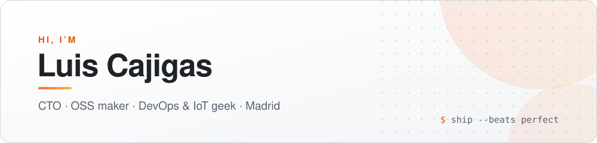

<picture>
  <source media="(prefers-color-scheme: dark)" srcset="assets/header-dark.svg">
  
</picture>

  
  
  

  10+ years building product — from embedded systems to global SaaS. 
  Currently CTO at <a href="https://www.doctorsim.com"><b>doctorSIM</b></a>, building AI tools that help millions unlock and switch phones worldwide. 
  On the side I ship open-source tools to scratch my own itches: <b>CLI utilities</b>, <b>desktop apps</b> and <b>server middleware</b>.

 

<!-- projects:start -->
## 🚀 Featured

Versions follow the latest published release · installable from <a href="https://github.com/lcajigasm/homebrew-tap">lcajigasm/tap</a>

<table>
<tr>
<td width="33%" valign="top">
<h3><a href="https://github.com/lcajigasm/lux">lux</a></h3>

  

 
A folder opens with its children in the sidebar, and <code>lux file-a file-b</code> opens each file as its own tab.
  
<code>brew install --cask lcajigasm/tap/lux</code>
  
<a href="https://github.com/lcajigasm/lux">Repo</a> · <a href="https://lcajigasm.github.io/lux/">Website</a> · <a href="https://github.com/lcajigasm/lux/releases/download/v1.5.7/lux-macos-universal.dmg">Download .dmg</a>
</td>
<td width="33%" valign="top">
<h3><a href="https://github.com/lcajigasm/ownterm">ownterm</a></h3>

  

 
Local workflows stay on this machine: <code>ownterm-tui workflow add</code> saves a command for the palette, with no Warp account or telemetry.
  
<code>brew install --cask lcajigasm/tap/ownterm</code>
  
<a href="https://github.com/lcajigasm/ownterm">Repo</a> · <a href="https://lcajigasm.github.io/ownterm/">Website</a> · <a href="https://github.com/lcajigasm/ownterm/releases/download/v0.9.0/ownterm-macos-universal.dmg">Download .dmg</a>
</td>
<td width="33%" valign="top">
<h3><a href="https://github.com/lcajigasm/omega">omega</a></h3>

  

 
Private keys and credential files stay on the machine, <code>omega doctor</code> checks the configured model, and a 429 waits for <code>Retry-After</code>.
  
<code>brew install lcajigasm/tap/omega</code>
  
<a href="https://github.com/lcajigasm/omega">Repo</a> · <a href="https://lcajigasm.github.io/omega/">Website</a> · <a href="https://github.com/lcajigasm/omega/releases/download/v0.19.0/omega-macos-universal.dmg">Download .dmg</a>
</td>
</tr>
</table>
<!-- projects:end -->

 

## ⚡ More things I'm building

<table>
  <tr>
    <td width="50%" valign="top">
      <h3>🦀 Editors &amp; desktop</h3>
      <a href="https://github.com/lcajigasm/luxDoc"><b>luxDoc</b></a> <code>Rust</code> 
      Offline API documentation browser for macOS, Dash-compatible docsets.  
      <a href="https://github.com/lcajigasm/m3u-player"><b>m3u-player</b></a> <code>Electron</code> <code>JS</code> 
      Desktop IPTV player that solves CORS — full M3U/HLS support.
    </td>
    <td width="50%" valign="top">
      <h3>🤖 AI &amp; MCP</h3>
      <a href="https://github.com/lcajigasm/loop-engineering"><b>loop-engineering</b></a> <code>Shell</code> 
      Drive any project as verified loops from Claude Code and Codex — goal maps, scoped verify gates, budgets, receipts.  
      <a href="https://github.com/lcajigasm/things3-mcp"><b>things3-mcp</b></a> <code>JS</code> <code>MCP</code> 
      MCP server connecting Claude to Things 3 on macOS.  
      <a href="https://github.com/lcajigasm/goodlinks-mcp"><b>goodlinks-mcp</b></a> <code>JS</code> <code>MCP</code> 
      MCP server connecting Claude to GoodLinks — search, summarise, tag and export your reading list.
    </td>
  </tr>
  <tr>
    <td width="50%" valign="top">
      <h3>🧰 CLI &amp; productivity</h3>
      <a href="https://github.com/lcajigasm/gh-manager"><b>gh-manager</b></a> <code>Shell</code> 
      Terminal TUI/CLI to manage multiple GitHub accounts — switch, inspect tokens, assign per directory.  
      <a href="https://github.com/lcajigasm/bookmarks-sync"><b>bookmarks-sync</b></a> <code>Python</code> 
      Sync bookmarks between any two browsers on macOS — zero dependencies.  
      <a href="https://github.com/lcajigasm/site-ip-badge"><b>site-ip-badge</b></a> <code>JS</code> <code>Chrome MV3</code> 
      Chrome extension that shows the IP behind the current page — published on the Web Store.  
      <a href="https://github.com/lcajigasm/streamdeck-absence.io-plugin"><b>streamdeck-absence.io-plugin</b></a> <code>HTML</code> <code>JS</code> 
      Clock in/out on absence.io directly from your Stream Deck.
    </td>
    <td width="50%" valign="top">
      <h3>🐘 PHP</h3>
      <a href="https://github.com/lcajigasm/ZapCMS"><b>ZapCMS</b></a> <code>PHP</code> <code>Laravel</code> 
      Full CMS built with Laravel &amp; Tailwind CSS.  
      <a href="https://github.com/lcajigasm/maintenance-middleware"><b>maintenance-middleware</b></a> <code>PHP</code> 
      Slim 3 middleware for maintenance mode with zero config.
    </td>
  </tr>
</table>

 

## 🛠️ Tech stack

  

 

## 📊 Activity

  

<i>Ship beats perfect.</i>

